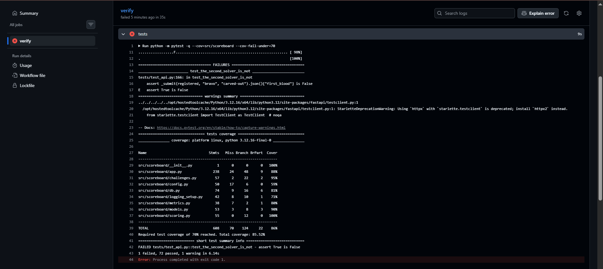
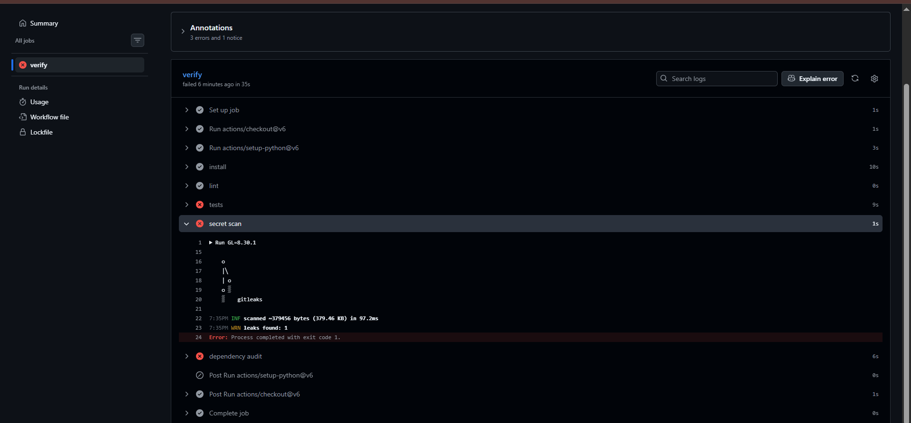
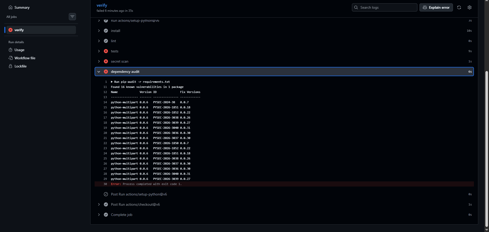

# TP2 CI Pipeline Diagnosis

I investigated the failed CI run using only its logs.

| Defect | Gate that failed | Name in the log | One-line cause |
|---|---|---|---|
| Test 1 | tests | test_the_second_solver_is_not | assert True is False |
| Test 2 | tests | N/A (Only 1 failed test shown) | N/A |
| Credential | secret scan | N/A (Name hidden in summary) | leaks found: 1 |
| Dependency | dependency audit | python-multipart | Found 16 known vulnerabilities |

- Test 1 failure type: assertion
- Test 2 failure type: N/A

